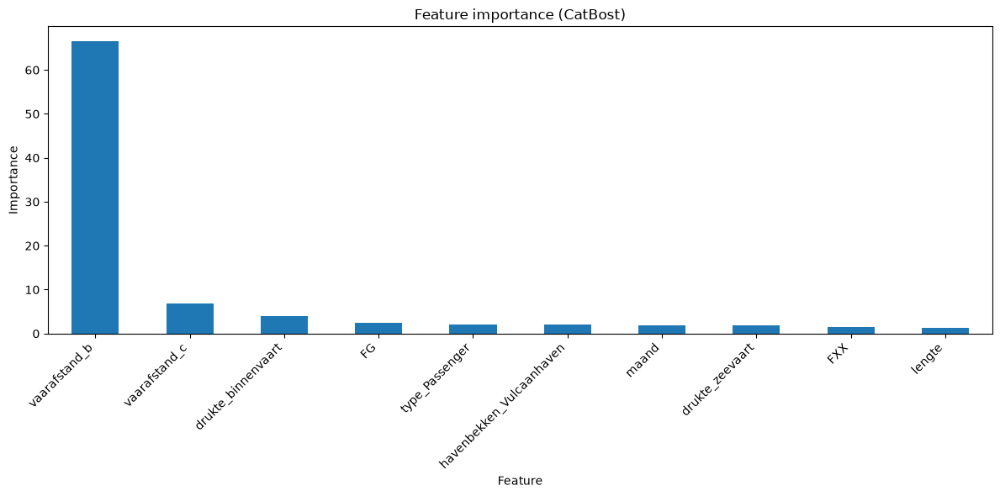
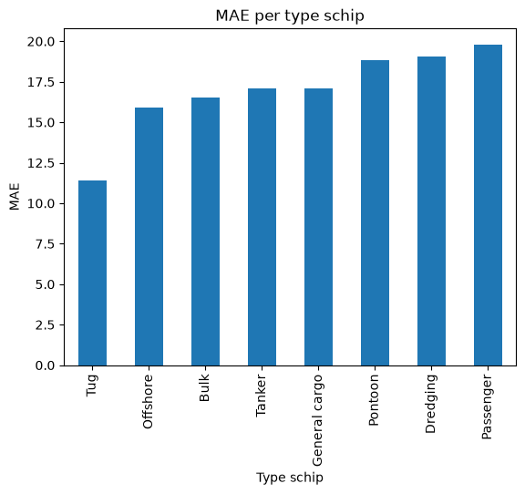

# Port of Rotterdam – Ship Travel Time Prediction

A machine learning project for the **Port of Rotterdam**, completed as a team assignment in the Applied Data Science & AI programme at Hogeschool Rotterdam (Studio 4 – Machine Learning, 2025–2026).

**Goal:** predict how long a ship takes to travel from the port entrance to its destination basin (*havenbekken*), so captains, logistics planners and port authorities can plan traffic better.

## Results

Three regression models were trained and compared on a held-out test set (10%):

| Model | MAE (min) | RMSE (min) | R² |
|---|---|---|---|
| **Linear Regression** | **17.16** | **21.51** | **0.678** |
| CatBoost | 17.21 | 21.53 | 0.678 |
| Decision Tree | 18.43 | 23.11 | 0.628 |

5-fold cross-validation for Linear Regression gives an MAE of 17.20 minutes, so the result is stable.

**Chosen model: Linear Regression.** It performs as well as CatBoost and is far easier to explain to the client, which matters for decisions in port operations.

## Approach

**1. Data preparation**
- Converted draught and ship length to metres.
- Extracted time features (hour, month, day of week) from the timestamp.
- Removed outliers in the travel-time segments with the IQR method.

**2. Feature engineering**
- **Sailing distance** per route segment (a, b, c), mapped from the destination basin.
- **Weather data** from KNMI (Rotterdam Geulhaven): average wind speed (`FG`) and maximum wind gust (`FXX`), merged by date.
- **Port traffic**: number of sea-going and inland vessels at the time of travel.
- **Ship properties**: draught, length, number of tugboats, speed class, ship type, turning manoeuvre.
- One-hot encoding of categorical features (CatBoost was also tested with native categorical handling).

**3. Modelling & evaluation**
- Linear Regression, Decision Tree (`max_depth=10`) and CatBoost (500 iterations, depth 6, learning rate 0.05).
- Metrics: MAE, RMSE, R², plus cross-validation.

**4. Explainability & bias**
- Feature importance for all three models.
- Error analysis per ship type, which shows a **representation bias**: general cargo and tankers make up most of the data, while rare types (navy, workships) are underrepresented.

<p align="center">
  
  
</p>

## Repository structure

```
├── notebooks/
│   └── travel_time_pipeline.ipynb   # full ML pipeline with outputs
├── report/
│   └── ml_report_nl.pdf             # ML report (Dutch): models, features, evaluation, bias, discussion
├── images/                          # charts from the notebook
└── requirements.txt
```

## Data

The training data (ship movements in the Port of Rotterdam) is **confidential client data** and is not included. The pipeline expects:

- `trainingsset.csv` – ship movements with travel times (provided by Port of Rotterdam)
- `weather.txt` – daily weather data from [KNMI](https://www.knmi.nl/nederland-nu/klimatologie/daggegevens) (station Rotterdam Geulhaven)

## My contribution

I worked on the ML pipeline with one teammate. My part was the **feature engineering** (sailing distances, time features, encoding, feature selection), **building and comparing the models**, and **creating the charts**. I also wrote the *Models* and *Features* sections of the report.

## Tech stack

Python · pandas · NumPy · scikit-learn · CatBoost · Matplotlib · Jupyter

## Run it

```bash
pip install -r requirements.txt
jupyter notebook notebooks/travel_time_pipeline.ipynb
```

Place `trainingsset.csv` and `weather.txt` next to the notebook.

---

*Team project – Hogeschool Rotterdam, ADS&AI, in collaboration with Port of Rotterdam.*
